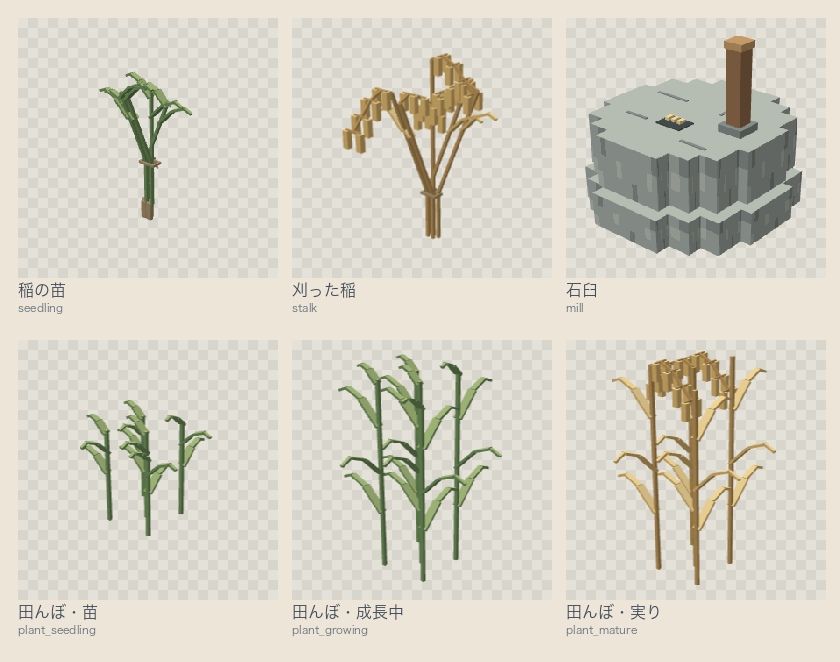

# 日ノ本鯖 テクスチャ（リソースパック）

Minecraft サーバー「日ノ本鯖」の、リソースパックの元データです。魚・料理・餌・釣竿・クーラーボックスの見た目を、アイテムの `item_model`（`hnmt:fish/<ID>` など）で差し替えます。サーバーのプラグイン（[hnmt-core](https://github.com/hnmt-mc/hnmt-core)）は、アイテムの名前を指すだけなので、**このパックがなくても、元のバニラの見た目で動きます**。

## 権利
**すべての権利を留保します。** このリポジトリは、公開していますが、許可なく、コピー・改変・再配布・他のサーバーでの利用はできません。ライセンス（利用許諾）は、設定していません。魚の元絵には、画像生成の出力を使い、あとから、整えています（作り方は `art/README.md`）。

## 配り方（サーバー運営向け）
- タグ（`v0.1.0` の形）を push すると、GitHub Actions が、検査して、リリースに2つを付けます。
  - `hnmt-textures.zip`: 配布用の3D版。
  - `pack.json`: 更新の情報（`version`・`url`・`sha1`・`id`）。
- hnmt-core は、`https://github.com/hnmt-mc/hnmt-textures/releases/latest/download/pack.json` を読み、Java版で参加した人へ、パックを送ります（統合版には送りません）。**パックを更新するには、新しいタグを打つだけ**で、サーバーの設定変更も、再起動も要りません（次の参加から、新しい版が配られます）。
- 統合版（Geyser）用には、リリースに、さらに4つが付きます（くわしくは下の「統合版（Geyser）」）。
  - `hnmt-bedrock.mcpack`: 統合版用のパック。
  - `hnmt.json`: Geyser のカスタムアイテムの対応づけ。
  - `hnmt_blocks.json`: Geyser のカスタムブロックの対応づけ（石臼）。
  - `bedrock.json`: 更新の情報（各ファイルの `name`・`target`・`url`・`sha1`）。
- 手でパックを入れたい人は、[リリース](https://github.com/hnmt-mc/hnmt-textures/releases/latest)から、`hnmt-textures.zip` を、`.minecraft/resourcepacks/` に置いてください。

---


釣りの魚、カスタム釣竿、餌の見た目のリソースパックです。プラグイン（hnmt-core）は、アイテムの `item_model` で `hnmt:fish/<ID>`・`hnmt:rod/<ID>`・`hnmt:bait/<ID>` を指しているだけなので、**このパックを入れなければ、元のバニラの見た目で表示されます**（プラグインの動作は変わりません）。

- 対象: Minecraft 1.21.11（`pack.mcmeta` の `min_format`・`max_format` は 75）。サーバーのバージョンを上げたときは、公式情報で確認してください。
- **ゲーム内での見え方は、まだ確認していません**（特に、3D版の GUI の中の角度と、額縁の向き）。

## 中身
| 場所 | 内容 |
| --- | --- |
| `assets/hnmt/textures/item/fish/<ID>.png` | 魚12種のテクスチャ（32x32のドット絵） |
| `assets/hnmt/textures/item/rod/<ID>.png` | 釣竿7本のテクスチャ（32x32。`_cast` は投げた状態） |
| `assets/hnmt/textures/item/bait/<ID>.png` | 餌4種のテクスチャ（32x32。`make_bait_art.py` で作る、輪郭のはっきりした絵） |
| `assets/hnmt/models/item/…` | 平らなアイコン版のモデル |
| `assets/hnmt/items/…` | 見た目の定義（釣竿は、投げた状態への切り替え付き） |
| `models3d/fish`・`models3d/bait` | 3D版のモデル（直方体の `elements`）。釣竿は、3D版も平らなので、ない |
| `models3d/dish` | 器と盛り付けを別々に組んだ料理32品の3Dモデル |
| `blockbench/dish` | 料理のBlockbench編集元。32×32テクスチャを埋め込み済み |
| `blockbench/board`・`assets/hnmt/models/block/board.json` | まな板のブロック（台の上にまな板と包丁が乗った形）の編集元とモデル |
| `assets/hnmt/textures/item/dish3d` | 料理3D版専用の32×32 UVアトラス。2Dアイコンとは別に管理 |
| `tools/` | テクスチャとモデルを作るスクリプト、zip を作るスクリプト |

魚の ID: `unagi`・`salmon`・`kohada`・`konoshiro`・`tai`・`hirame`・`saba`・`hamachi`・`buri`・`ika`・`kanpachi`・`maguro`（出世魚は、若魚と成魚で別の見た目）。
釣竿の ID: `bamboo`・`keiryu_nami`・`keiryu_jo`・`iso_nami`・`iso_jo`・`fune_nami`・`fune_jo`。餌の ID: `mimizu`・`ebi`・`iwashi`・`ika_no_mi`。

## 料理・素材の追加分

元のアイコンは32×32・RGBA・透過PNGです（米作り7種類だけは、バニラの作物に近い16×16です）。魚12・釣竿14状態・餌4・料理32・素材3・米作り7の計72種類があります。
料理3D版には、別途32枚の32×32・RGBAのUVアトラスを用意しています。
料理は`textures/item/dish/<ID>.png`・`items/dish/<ID>.json`・`models/item/dish/<ID>.json`、
米・いくら・まな板は`rice`・`ikura`・`board`として各ディレクトリの直下に置いています。
3Dモデルも`models3d/dish`および`models3d`直下へ収録しています。
料理と素材をJava側のitem_modelへ接続する変更は含めていません。

[絵の編集元・種類ごとの特徴・実物の釣竿の参考資料](art/README.md)も参照してください。

## 米作りのモデル

苗・刈った稲・石臼と、田んぼの成長3段階を追加しています。
炊いたあとのご飯 `hnmt:rice` はそのままで、新しい7種類は `hnmt:rice/<名前>` です。

| 名前 | 見た目 |
| --- | --- |
| `seedling` | 赤いひもで根元をまとめた緑の苗（平らなアイコン） |
| `stalk` | 黄金色の穂が垂れた稲の束（平らなアイコン） |
| `grain` | 白っぽい粒の小さな山（石臼で精米した、炊く前の米。平らなアイコン） |
| `mill` | 2段の石と投入口、木の取っ手がある石臼（直方体4個） |
| `plant_seedling` | 田んぼの短い苗（バニラの作物と同じ、交差した板2枚） |
| `plant_growing` | 葉が伸びた緑の稲（交差した板2枚） |
| `plant_mature` | 黄金色の穂が垂れた、刈り取り前の稲（交差した板2枚） |



編集元は `blockbench/rice/<名前>.bbmodel` です。Blockbench の **Java Block/Item** で開けます。
32×32のテクスチャを埋め込み、茎・葉・穂は `Stalk`・`Leaves`・`Ear`、石臼は `Base`・`Top`・`Handle` に分けています。
モデルは Minecraft 1.21.11 向けに書き出しています。1品につきテクスチャ1枚、直方体と標準の回転だけを使用します。

書き出し先は `models3d/rice/<名前>.json` と `assets/hnmt/textures/item/rice/<名前>.png` です。
`assets/hnmt/models/item/rice/` は平らなアイコン版です。`make_models.py` は、米作りのBlockbench書き出しを上書きしません。

田んぼ用は足元を `y=-1` まで伸ばし、幅を1ブロックの内側に収めています。
石臼の底は `y=0` で、既存のハーフブロックの上に重ねる前提です。
`fixed` は回転なし・平行移動なし・等倍です。Blockbench の書き出しで既定値が省略されても、同じ配置になります。
**ゲーム内の高さ・手持ち・GUI表示は未確認です。統合版の対応表には、この6種類をまだ追加していません。**

座標から作り直す場合は、先にBlockbenchでの手編集を保存・コミットしてください。次の処理は編集元を上書きします。

```sh
python3 tools/make_rice_models.py
PLAYWRIGHT_MODULE="$(pwd)/build/blockbench-tools/node_modules/playwright" \
  node tools/blockbench_rice.cjs
python3 tools/make_rice_models.py --review
python3 -m unittest discover -s tools -p test_rice_models.py
sh tools/build_zip.sh
python3 tools/verify_pack.py
```

Playwrightの準備は「料理の3Dモデルを編集する」と共通です。
`CHROME_PATH` を指定すると、インストール済みのChromeを利用できます。
Blockbench Web 5.2.2で7種類の書き出しと、編集元の再読み込みを確認しています。
プレビューと確認記録は `build/rice3d/` に出力します。Blenderは使用しません。

## クーラーボックス
魚専用の持ち運び箱（`hnmt:cooler/small`・`medium`・`large`）の見た目です。テクスチャは32x32で、輪郭と本体・蓋・氷・留め具の8色だけで描いています。モデルは直方体6〜8個の3Dで、平らなアイコン版・3D版のどちらの zip にも同じものが入ります。パックがなければ、元の樽のまま表示されます。

作り直すとき（Blender 4以降。検証は5.2.3）:
```sh
blender --background --factory-startup --python tools/blender_coolers.py -- --render
python3 -m unittest discover -s tools -p 'test_blender_coolers.py'
```
`build/cooler/` に、プレビュー（`preview.png`）と、置き換え用のファイルが出ます。ゲーム内での見え方は未確認です。

## 統合版（Geyser）

統合版のプレイヤーには、Java 版のパックは送られません。かわりに、3Dモデルのある品を、統合版用のパックと Geyser の対応づけに直して、リリースに付けます。

| ファイル | 置き先（Geyser のフォルダの中） | 内容 |
| --- | --- | --- |
| `hnmt-bedrock.mcpack` | `packs/` | 統合版用のパック（ジオメトリ・attachable・アニメーション・アイコン） |
| `hnmt.json` | `custom_mappings/` | `item_model` と、統合版のアイテムの対応づけ（カスタムアイテム API の形式2） |
| `hnmt_blocks.json` | `custom_mappings/` | カスタムブロックの対応づけ（形式1）。石臼を、見せかけのブロックの状態に結ぶ |
| `bedrock.json` | （置かない） | 更新の情報。置くファイルの名前・置き先・URL・SHA-1 |

### 対象
- 魚12・餌4・料理32・クーラーボックス3・ご飯・いくら・まな板・稲の苗・刈った稲・炊く前の米・石臼の、**58品**。田んぼに立つ稲（`rice/plant_*`）は、世界に出す表示用で、統合版で見えるかが未確認なので入れません。
- 町メニュー（`hnmt-townymenu`）のアイコン48種類も含めます。上の58品と合わせて、対応表は**106品**です。アイコンごとの元のアイテムは `tools/menu_icons.json` に定義し、`tools/bedrock_bases.json` と町メニュー側の定義を揃えています。
- **釣竿は入れません。** 統合版では、釣竿をカスタムアイテムにすると、釣りボタンが出ず、手に持つ向きも反転するためです。ふつうの釣竿のままです。

### 町メニューのアイコン

`hnmt.json` と `hnmt-bedrock.mcpack` を、同じビルドから組にして更新します。
町メニューも、アイコンごとに元のアイテムを統一した版を使います。
サーバーを停止してから差し替え、Geyserを再起動してください。

2026-10-24にPaper 1.21.11とGeyser-Spigot 2.12.0-SNAPSHOTの検証環境で、106品の対応表を読み込み、`Registered 107 custom items` を確認しました。106品は対応表の対象数、107個はこの検証環境でGeyserが報告した登録総数です。
Java版のbotで、実際の町メニューから届くモデルと元のアイテムが、配置したGeyser対応表に一致することも確認しました。
**統合版端末での絵・文字・操作感は未確認です。** 登録ログだけでは表示確認済みとしません。

### 石臼とまな板のカスタムブロック
田んぼの稲は、統合版の人には、サーバーが小麦のブロックを見せかけで送ります（パックは関係しません）。石臼とまな板は、Java 版では**土台のブロックを置き換えた見た目**で、統合版には `ItemDisplay` がないので、**土台のブロックそのものを、カスタムブロックに置き換えます。**

- 土台は、どちらも**石化したオークのハーフブロック**です（ふだん使われないので、ほかの建築に影響しません）。**石臼は下半分**（`type=bottom`）、**まな板は2段**（`type=double`）で、状態で分かれます。アイテムの元も、このブロックです（`tools/bedrock_bases.json` の `rice/mill` と `board`）。
- 対応づけは `tools/bedrock_blocks.json`（アイテムID → `java_block`・`state`・`slab_height`・`display_name`・（`model`））です。`java_block` は、アイテムの元のブロックと同じにしてください（テストで確かめています）。同じ Java のブロックの、別の状態に、別のブロックを結べます。**同じ状態を2つのブロックが使うことはできません。**
- 形は、Java 版のモデルから作ります。石臼は、ハーフブロックの上に立つので、ブロックの高さ 16 に収まるよう、モデルの縦だけを縮めます（`slab_height` が 8）。まな板は、台の上にまな板と包丁が乗ったブロック1個ぶんのモデル（`model` に `block/board`、`slab_height` が 0 でハーフブロックを足さない）です。
- 一度、サーバーが別のブロックの状態を、統合版の人にだけ見せかけで送る方式を試しましたが、**統合版で壊せませんでした**。Geyser は壊す処理を、サーバー上の本物のブロックで進めるので、見せかけと食い違うためです。いまは、本物の土台を置き換える形にしています。
- Java 版では、石化したオークのハーフブロックが、オークの板の見た目になるので、`assets/minecraft/blockstates/petrified_oak_slab.json` で、下半分はなめらかな石（石臼の土台）、2段は `hnmt:block/board`（まな板）にしています。パックを入れていない人は、オークの板の見た目の土台になります。
- まな板のブロックの絵は `tools/make_board_block.py`（16px の絵と座標）で作り、`tools/blockbench_board.cjs` で Blockbench 本体から書き出します（編集元は `blockbench/board/board.bbmodel`、モデルは `assets/hnmt/models/block/board.json`、絵は `assets/hnmt/textures/block/board.png`）。
- ブロックのジオメトリの名前は、アイテム用（`geometry.hnmt_<名前>`）と別（`geometry.hnmt_block_<名前>`）にしてください。同じだと、手に持った品が消えます（テストで確かめています）。

### 自動で置く
hnmt-core のリポジトリの `geyserpacks/`（`hnmt-geyserpacks.jar`）が、`bedrock.json` を取って、Geyser のフォルダに置きます。Paper（Geyser-Spigot）と Velocity（Geyser-Velocity）の両方で動きます。置いたあとは、**Geyser の再起動で反映**されます。

### 作り方
```sh
python3 tools/make_bedrock.py . build/bedrock v0.1.0     # パックと対応づけ
python3 tools/make_bedrock_manifest.py v0.1.0 build/bedrock   # bedrock.json
python3 -m unittest discover -s tools -p 'test_make_bedrock*.py'
```
- 変換は `tools/make_bedrock.py` です。Java 版の直方体（`elements`）を、統合版の `cube` に直します。x 軸を逆向きにし、上と下の面の UV を入れ替え、回転は x 軸の角度の向きを逆にします（Geyser の変換 mod Rainbow と同じ規則）。
- 元の Java のアイテム（魚は `minecraft:tropical_fish` など）の表は `tools/bedrock_bases.json` です。hnmt-core の `config.yml` の `base`（魚の段階・餌・料理の種類）と、コードの定数から作ります。**hnmt-core 側で元のアイテムを変えたら、この表も直します。** hnmt-core のテスト（`BedrockBasesTest`）が、食い違いを見つけます。そのときは、この表を直して新しいタグを打ち、テストの写し（`src/test/resources/bedrock_bases.json`）も同じに直します。
- Geyser は、起動のときにしかファイルを読みません。

### 向きの決め方
- 一人称の回転は、Rainbow の式ではなく、**実機の統合版で見比べて決めた式**（回転 = `[-ry, rz, rx]`）です。Rainbow の式のままだと、尻尾か真正面を向きました。
- 三人称と、頭に乗せたときは、Rainbow の式のままで、**まだ実機で見比べていません。**

### 確認したこと・未確認
- 変換・パック・対応づけの構造は、単体テストで確かめています。統合版の端末で、持ち物の中の絵と、一人称の見た目を確かめました（品によっては、未確認）。
- 未確認: 三人称、頭に乗せたとき、床に落ちたとき、額縁、Velocity での動き。

## 2つの版
- **平らなアイコン版**（`hnmt-textures-flat.zip`）: バニラの魚と同じ見せ方。
- **3D版**（`hnmt-textures.zip`）: 魚は、胴の断面を楕円にして、背と腹に向かって薄くなる丸みを付けています（魚1匹あたり直方体は80〜120個）。餌・米・いくらは、正面が2Dの絵のままで、奥行きは後ろへ伸びる輪切りです。料理32品は、底・側面・縁のある器と、ご飯・具材・薬味を別々の直方体で組み、1品1枚の32×32テクスチャを使います。料理にはJava版で対応するY軸22.5度・45度の回転があり、統合版への変換は未検証です。釣竿は、3D版でも、平らなアイコンのままです（竿は細く、立体にすると不自然になるため）。上面・下面・端の面は、輪郭の暗い線を除いた中身の色です。

## 料理の3Dモデルを編集する

Blockbenchで `blockbench/dish/<ID>.bbmodel` を開きます。
形式は **Java Block/Item** です。器・料理・薬味は `Vessel`・`Food`・`Garnish` のグループに分けています。
テクスチャはプロジェクトに埋め込んでいるため、画像ファイルを探さずに編集を始められます。

PNGを書き出す先は `assets/hnmt/textures/item/dish3d/<ID>.png`、
Block/Item Modelを書き出す先は `models3d/dish/<ID>.json` です。
既存の `textures/item/dish` と `models/item/dish` は2D版なので、上書きしないでください。

制作と書き出しはBlockbench Web 5.2.2で確認しました。
丼は空洞のある八角形の器、皿は浅い縁と高台がある器です。
いくらは段差のある粒、握りはご飯の山と端の薄いネタ、刺身は重ねた切り身として作っています。
曲面メッシュは使わず、Minecraftの直方体と対応角度の回転で形を近づけています。

座標から再生成する場合は、次のコマンドを使います。生成済みファイルへの手動編集は上書きされるので、先に保存・コミットしてください。

```sh
python3 tools/make_food_models.py
```

Blockbench本体で編集元・JSON・プレビューを再書き出しする場合は、Node.jsとPlaywrightが必要です。
作業用の依存関係は配布パックに入りません。Web版に接続できる環境で実行してください。

```sh
npm install --prefix build/blockbench-tools playwright
build/blockbench-tools/node_modules/.bin/playwright install chromium
PLAYWRIGHT_MODULE="$(pwd)/build/blockbench-tools/node_modules/playwright" \
  node tools/blockbench_food.cjs
python3 tools/make_food_models.py --review
python3 -m unittest discover -s tools -p test_food_models.py
sh tools/build_zip.sh
python3 tools/verify_pack.py
```

個別プレビューと32品の一覧は `build/food3d/` に出力します。
ゲーム内のGUI・手持ち表示と、Geyserでの表示は未検証です。

## zip を作る
```sh
sh tools/build_zip.sh        # 3D版（hnmt-textures.zip）
sh tools/build_zip.sh flat   # 平らなアイコン版（hnmt-textures-flat.zip）
```
`build/` に zip ができ（Git には入れません）、SHA-1 が表示されます。リリース用の `pack.json` は、`python3 tools/make_manifest.py v0.1.0` で作れます（タグは、実際のリリースで、自動で付きます）。3D版のモデルは `models3d` にあるので、Blender は要りません。

## サーバーへ配る（手動）
プラグインを使わずに配るときは、zip を、サーバーから直接ダウンロードできる URL に置き、`server.properties` に設定します。
```properties
resource-pack=<zip の URL>
resource-pack-sha1=<build_zip.sh が表示した SHA-1>
require-resource-pack=false
```
パックを更新したら、SHA-1 も必ず更新してください（プレイヤーのキャッシュが古いままになります）。

## 作り直す（開発者向け）

Python 3とPillow、プレビューにはBlenderを使用します。検証環境はBlender 5.2.3です。

```sh
python3 -m venv build/venv
build/venv/bin/pip install -r tools/requirements.txt
build/venv/bin/python tools/make_fish_art.py
build/venv/bin/python tools/make_textures.py
build/venv/bin/python tools/make_rods.py
build/venv/bin/python tools/make_bait_art.py
build/venv/bin/python tools/make_food_art.py
build/venv/bin/python tools/make_pack.py
build/venv/bin/python tools/make_models.py
/Applications/Blender.app/Contents/MacOS/Blender --background --python tools/blender_preview.py
build/venv/bin/python tools/make_3d_sheet.py
sh tools/build_zip.sh
sh tools/build_zip.sh flat
build/venv/bin/python tools/verify_pack.py
```

`make_models.py`はBlenderを使わず、テクスチャ1枚と軸に沿った直方体だけでJSONを作ります。
魚は16〜32個以内に制限し、モデル座標・UV・参照先・通常と投げた状態の違いを`verify_pack.py`で検査します。
既存の`blender_fish3d.py`・`blender_rod3d.py`・`blender_bait3d.py`は分類ごとの再生成とプレビュー用です。
これらは`python3`からPillowを読み込める環境で実行してください。

一覧画像は`build/`、全72種類の個別プレビューは`build/preview3d/`へ出力します。
制作物とプレビューはゲーム内検証の代わりにはなりません。Geyser/Rainbowでの変換、
ゲーム内の手持ち角度・額縁・GUIでの表示、料理の機能との接続は未検証です。
